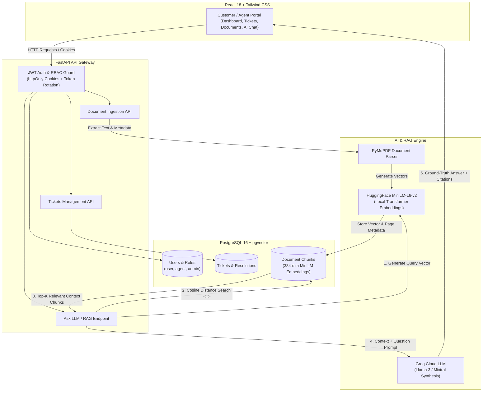

# 🤖 ResolveIQ AI — Enterprise Customer Support Copilot

[](https://github.com/AyushKumar4847/ResolveIQ-AI/actions/workflows/ci.yml)


**ResolveIQ** is a production-grade, full-stack AI Customer Support Copilot designed to transform static technical documentation and PDFs into an intelligent, contextual support assistant. It couples high-performance **Vector Search (pgvector)**, **Groq Cloud LLMs**, and strict **Enterprise Role-Based Access Control (RBAC)** to empower support agents with instant, citation-backed answers.

---

## 🏛️ System Architecture



---

## 🌟 Key Engineering Highlights

### 1. 🧠 Retrieval-Augmented Generation (RAG) with Ground-Truth Citations
* **Document Ingestion:** Ingests complex multi-page PDFs using PyMuPDF and chunks them using `RecursiveCharacterTextSplitter` (700 characters with 100 character overlap).
* **Local Transformer Embeddings:** Generates 384-dimensional dense vectors locally using `sentence-transformers/all-MiniLM-L6-v2`.
* **Cosine Distance Vector Search:** Stores vectors directly in PostgreSQL using the `pgvector` extension with Cosine Distance (`<=>`) queries for sub-millisecond similarity lookups.
* **Exact Evidence Citations:** Every AI-generated answer provides exact source document names, page numbers, and quoted snippet citations to eliminate hallucinations.

### 2. 🛡️ Enterprise Security & RBAC (Role-Based Access Control)
* **Dual-Token Authentication:** Secure JWT architecture with short-lived Access Tokens (30 minutes) and persistent Refresh Tokens (7 days) with database token rotation.
* **XSS Attack Prevention:** Sensitive tokens are transmitted exclusively via secure `httpOnly` cookies.
* **Role Hierarchy:** Three distinct tiers (`user`, `agent`, `admin`):
  * `user`: Can view and create tickets; document upload is strictly locked down (`403 Forbidden`).
  * `agent`: Full access to the AI Copilot, ticket resolution workflow, and knowledge base document uploads.
  * `admin`: Complete administrative oversight with an interactive User Management portal to promote or demote user roles.

### 3. 🎫 End-to-End Ticketing & Resolution Lifecycle
* **Creator Tracking:** Every ticket tracks creator identity (`owner_id`), resolution status (`open`, `in_progress`, `resolved`), and resolution history.
* **Agent Copilot Assistance:** Agents can resolve tickets directly by pulling AI answers into ticket resolution logs with a single click.

### 4. 📊 Quantitative Evaluation Benchmark
* Features an automated evaluation suite (`tests/evaluation/evaluate_rag.py`) testing **30 domain-specific questions** against ground-truth evidence to measure accuracy, retrieval precision, and response latency.

### 5. 🐳 Production Containerization & CI/CD
* **Layer-Cached Dockerfile:** Optimized build steps ensuring dependencies and system packages are cached, slashing rebuild times from minutes to **35 seconds**.
* **Docker Compose Orchestration:** Multi-container bridge network orchestrating the FastAPI backend and `pgvector/pgvector:pg16` database with persistent volume storage.
* **GitHub Actions CI Pipeline:** Automated CI runner executing Alembic migrations and 15 integration/unit tests on ephemeral Ubuntu + pgvector containers on every `git push`.
* **AWS Cloud Native Deployment:** Deployed on an AWS EC2 instance (Sydney region) with Linux Swap Memory management to prevent Out-Of-Memory (OOM) crashes under heavy embedding workloads.

---

## 🛠️ Technology Stack

| Component | Technology | Purpose |
| :--- | :--- | :--- |
| **Backend Framework** | **FastAPI** (Python 3.12) | Asynchronous high-performance RESTful API |
| **ORM & Migrations** | **SQLAlchemy 2.0** + **Alembic** | Modern typed ORM and automated database migrations |
| **Database & Vector Store** | **PostgreSQL 16** + **pgvector** | Relational data + 384-dim semantic vector search |
| **Embeddings Model** | **Sentence-Transformers** (`all-MiniLM-L6-v2`) | Local contextual dense text embeddings |
| **LLM Inference** | **Groq Cloud API** (`langchain-groq`) | Blazing fast LLM inference (Llama 3 / Mixtral) |
| **Document Parsing** | **PyMuPDF** (MuPDF C-engine) | Fast, accurate PDF page-by-page text extraction |
| **Frontend UI** | **React 18** + **Tailwind CSS** + **Vite** | Modern responsive dark-mode dashboard |
| **Security & Cryptography** | **python-jose** + **passlib** + **bcrypt** | JWT token signatures and cryptographic password hashing |
| **Containerization** | **Docker** & **Docker Compose** | Production image packaging & multi-container orchestration |
| **CI/CD** | **GitHub Actions** | Automated testing, linting, and database migration checks |
| **Cloud Hosting** | **AWS EC2** (Ubuntu 24.04 LTS) | 24/7 cloud server deployment with Swap memory |

---

## 🚀 Quick Start Guide

### Option A: Run with Docker Compose (Recommended - 1 Command!)

Ensure [Docker Desktop](https://www.docker.com/) is installed and running:

```bash
# 1. Clone the repository
git clone https://github.com/AyushKumar4847/ResolveIQ-AI.git
cd ResolveIQ-AI

# 2. Setup your environment variables
cp .env.example .env
# Edit .env and paste your GROQ_API_KEY and SECRET_KEY

# 3. Build and launch all containers
docker compose up -d --build

# 4. Run database migrations inside the container
docker compose exec api alembic upgrade head
```

* **Interactive API Documentation (Swagger):** [http://localhost:8000/docs](http://localhost:8000/docs)
* **Backend API Base:** `http://localhost:8000`

---

### Option B: Local Python Development Setup

```bash
# 1. Create and activate a Python virtual environment
python -m venv .venv
source .venv/bin/activate       # On Linux/macOS
.\.venv\Scripts\activate        # On Windows

# 2. Install dependencies
pip install -r requirements.txt

# 3. Setup PostgreSQL with pgvector (via Docker)
docker compose up -d db

# 4. Configure environment variables
cp .env.example .env

# 5. Apply database migrations
alembic upgrade head

# 6. Start the development server
uvicorn app.main:app --reload --host 0.0.0.0 --port 8000
```

---

### Starting the Frontend UI

```bash
cd frontend
npm install
npm run dev
```
* **Frontend Portal:** [http://localhost:5173](http://localhost:5173) (or `http://localhost:3000`)

---

## 🧪 Testing & Verification

The test suite contains full integration and unit tests covering authentication, ticket lifecycle, PDF ingestion, and RBAC lockdown permissions:

```bash
# Run the complete test suite
pytest -v
```

### Test Coverage Highlights:
* `test_tickets.py`: Tests CRUD operations, 404 handling, and creator ownership constraints.
* `test_documents.py`: Tests valid PDF ingestion, invalid file-type rejections (400), and **403 Forbidden security verification** ensuring non-agents cannot upload documents.
* `test_ask_llm.py`: Tests question validation (422) and mocked LLM response serialization.
* `test_ingestion.py`: Tests PyMuPDF parsing, chunking integrity, and 384-dimensional embedding generation.

---

## 📡 API Endpoints Overview

| Method | Endpoint | Description | Access Tier |
| :--- | :--- | :--- | :--- |
| `POST` | `/auth/register` | Register a new user | Public |
| `POST` | `/auth/login` | Authenticate user & issue httpOnly cookies | Public |
| `GET` | `/auth/me` | Fetch authenticated user profile & role | Authenticated |
| `POST` | `/auth/logout` | Revoke session & clear cookies | Authenticated |
| `GET` | `/tickets/` | List tickets | Authenticated |
| `POST` | `/tickets/` | Create a new support ticket | Authenticated |
| `GET` | `/tickets/{id}` | Get ticket details & resolutions | Authenticated |
| `DELETE`| `/tickets/{id}` | Delete a ticket | Authenticated |
| `POST` | `/documents/upload` | Upload & ingest PDF into pgvector | **Agent / Admin Only (403 for user)** |
| `GET` | `/documents/` | List all ingested knowledge documents | Authenticated |
| `DELETE`| `/documents/{id}` | Remove document and vector chunks | **Agent / Admin Only** |
| `POST` | `/ask/` | Query RAG Copilot with citations | Authenticated |

---

## 👤 Author & Acknowledgements

* **Developed by:** Ayush Kumar ([@AyushKumar4847](https://github.com/AyushKumar4847))
* **Built as a Production-Grade AI Engineering Portfolio Project.**

